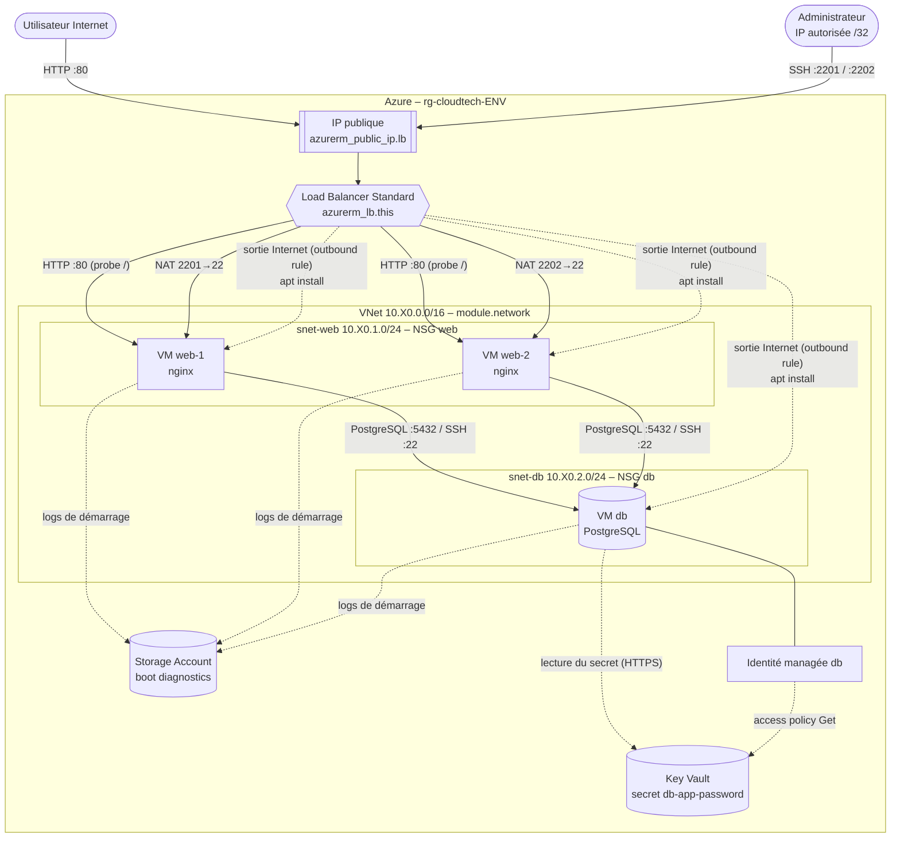
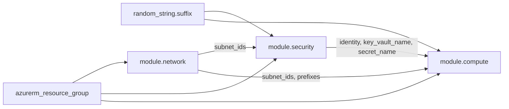
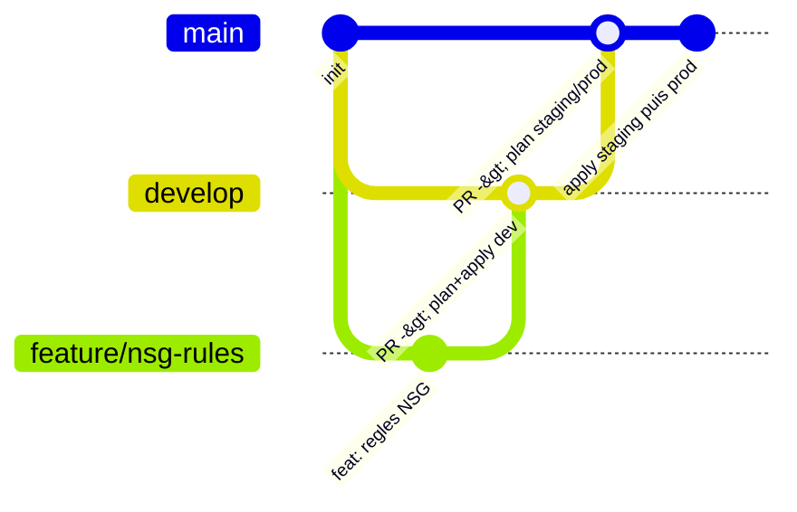

# Dossier d'Architecture Technique (DAT)

## 1. Vue d'ensemble

Chaque environnement (`dev`, `staging`, `prod`) est un **Resource Group isolé** contenant la même architecture, paramétrée par `terraform.tfvars` :

| Composant | Ressource Terraform | Qté | Rôle |
|---|---|---|---|
| Resource Group | `azurerm_resource_group.this` | 1 | Conteneur de l'environnement |
| Virtual Network | `module.network.azurerm_virtual_network.this` | 1 | Réseau privé `10.X0.0.0/16` |
| Subnets | `module.network.azurerm_subnet.this["web"/"db"]` | 2 | `snet-web` (10.X0.1.0/24), `snet-db` (10.X0.2.0/24) |
| NSG | `module.security.azurerm_network_security_group.this["web"/"db"]` | 2 | Pare-feu par sous-réseau |
| IP publique | `module.compute.azurerm_public_ip.lb` | 1 | Seule IP publique de l'environnement |
| Load Balancer | `module.compute.azurerm_lb.this` (+ pools, probe, règles) | 1 | HTTP 80 → VMs web, NAT SSH, sortie Internet |
| VMs web | `module.compute.azurerm_linux_virtual_machine.web[0..1]` | 2 | Ubuntu 24.04 + nginx |
| VM db | `module.compute.azurerm_linux_virtual_machine.db` | 1 | Ubuntu 24.04 + PostgreSQL |
| Storage Account | `module.compute.azurerm_storage_account.diag` | 1 | Diagnostics de démarrage |
| Key Vault | `module.security.azurerm_key_vault.this` | 1 | Mot de passe PostgreSQL |
| Identité managée | `module.security.azurerm_user_assigned_identity.db` | 1 | Permet à la VM db de lire son secret |

Plages d'adresses : dev `10.10.0.0/16`, staging `10.20.0.0/16`, prod `10.30.0.0/16` (pas de chevauchement → un peering futur reste possible).

## 2. Diagramme d'architecture et flux

### Flux réseau autorisés

| Source | Destination | Port | Contrôle |
|---|---|---|---|
| Internet | LB → VMs web | 80/TCP | Règle LB `rule-http` + NSG web `Allow-HTTP-Internet` |
| IP admin | LB → web-1 / web-2 | 2201, 2202 → 22 | NAT LB + NSG web `Allow-SSH-Admin` (IP /32 uniquement) |
| snet-web | VM db | 5432, 22 | NSG db `Allow-PostgreSQL-From-Web`, `Allow-SSH-From-Web` |
| tout le reste | VM db | * | NSG db `Deny-All-Other-Inbound` (priorité 4000) |
| VMs | Internet | sortant | Outbound rule du LB (SNAT sur l'IP publique) |
| VM db | Key Vault | 443 | Identité managée + access policy `Get` |

## 3. Dépendances entre composants (graphe Terraform)

Dans les modules :
- `azurerm_subnet` dépend du VNet ; les **associations NSG** dépendent des subnets et des NSG ;
- `azurerm_key_vault_secret` dépend de l'access policy de Terraform (sinon écriture refusée) ;
- l'output `key_vault_name` dépend de l'access policy de la VM db → la VM db ne démarre qu'une fois son droit de lecture créé ;
- les VMs dépendent de l'**outbound rule** du LB (sinon `apt install` échoue au premier démarrage) ;
- `module.compute` dépend explicitement de `module.security` (NSG appliqués avant que les VMs n'existent).

Visualiser le graphe réel : `terraform graph | dot -Tsvg > graph.svg` (Graphviz).

## 4. Choix d'architecture

| Choix | Justification |
|---|---|
| Aucune IP publique sur les VMs | Surface d'attaque minimale, 1 seule IP publique (quota étudiant) |
| SSH via NAT du Load Balancer | Évite un Bastion (payant) tout en gardant SSH limité à une IP |
| Outbound rule explicite | Les VMs derrière un LB Standard n'ont pas d'accès Internet par défaut |
| Standard_B1s partout | Taille la moins chère, éligible à l'offre gratuite étudiante |
| Disque SSD en prod uniquement | Fonction ternaire `environment == "prod" ? ...` : coût maîtrisé hors prod |
| Mot de passe DB dans Key Vault | Aucun secret dans le code, Git ou cloud-init |
| Un dossier par environnement | Isolation des states et des droits, workflow Git par environnement |

## 5. Workflow Git

| Branche | Rôle | Déclenche |
|---|---|---|
| `feature/*` | Développement | CI (fmt, validate, tests, tflint, trivy, sentinel) |
| `develop` | Intégration | CI + run HCP Terraform sur **cloudtech-dev** |
| `main` | Release | CI + runs HCP Terraform sur **cloudtech-staging** puis **cloudtech-prod** (confirmation manuelle) |

Règles : pas de push direct sur `main`, merge via Pull Request uniquement après CI verte et plan relu.
